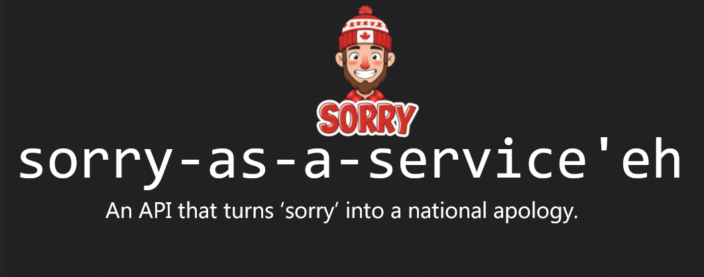

# ❌ Sorry-as-a-Service'eh

<p align="center">
  
</p>


Ever needed a polite way to say “sorry, eh”?
This tiny API delivers random, overly apologetic, overly polite, and occasionally hilarious Canadian-style rejections — ideal for any situation: awkward social moments, workplace letdowns, ghosting politely, or just because you're Canadian and feel bad about everything.

Built for humans, humility, and humor. Sorry in advance. 🍁

---

## 🚀 API Usage

**Base URL**
```
https://naas.sh/eh
```

**Method:** `GET`
**Rate Limit:** `120 requests per minute per IP`

### 🔄 Example Request
```http
GET /eh
```

### ✅ Example Response
```json
{
  "reason": "Sorry, I’d say yes, but the geese advised against it."
}
```

Use it in apps, bots, landing pages, Slack integrations, apology notes, or wherever you need a polite (or hilariously Canadian) “sorry, eh?”

---

## 🛠️ Self-Hosting

Want to run it yourself? It’s lightweight and simple.

### 1. Clone this repository
```bash
git clone https://github.com/3xHelix/sorry-as-a-service.git
cd sorry-as-a-service
```

### 2. Install dependencies
```bash
npm install
```

### 3. Start the server
```bash
npm start
```

The API will be live at:
```
http://localhost:4242/eh
```

You can also change the port using an environment variable:
```bash
PORT=9090 npm start
```

---

## 📁 Project Structure

```
no-as-service/
├── index.js            # Express API
├── sorries.json        # 600+ universally polite Canadian-style sorry reasons, eh [More to come soon'eh]
├── package.json
├── .devcontainer.json  # VS Code / Github devcontainer setup
└── README.md
```

---

## 📦 package.json

For reference, here’s the package config:

```json
{
  "name": "sorry-as-service'eh",
  "version": "1.0.0",
  "description": "A lightweight API that returns random, polite Canadian-style rejection or 'sorry' reasons, eh.",
  "main": "index.js",
  "scripts": {
    "start": "node index.js"
  },
  "author": "hotheadhacker, adapted by 3xHelix",
  "license": "MIT",
  "dependencies": {
    "express": "^4.18.2",
    "express-rate-limit": "^7.0.0"
  }
}
```

---

## ⚓ Devcontainer

If you open this repo in Github Codespaces, it will automatically use `.devcontainer.json` to set up your environment.  If you open it in VSCode, it will ask you if you want to reopen it in a container.

---
## Projects Using No-as-a-Service

Here are some projects and websites that creatively integrate [no-as-a-service](https://naas.isalman.dev/no) to deliver humorous or programmatic "no" responses:

1. **[no-as-a-service-rust](https://github.com/ZAZPRO/no-as-a-service-rust)**  
   Rust implementation of this project.

2. **[CSG Admins](https://csg-admins.de)**  
   A system administration and gaming service hub using no-as-a-service to provide playful negative responses across some admin panels and commands.

3. **[FunnyAnswers - /no endpoint](https://www.funnyanswers.lol/no)**  
   A humor-focused API playground that includes a mirror or wrapper for no-as-a-service, perfect for developers exploring fun HTTP-based responses.

4. **[Gerador de Frases Aleatórias (pt-BR)](https://github.com/timeuz/frases-aleatorias)**
   Uma reinterpretação em Python com frases em português, frontend e novas categorias.

5. **[NoAsAnApp](https://github.com/omar-jarid/NoAsAnApp)**  
   A simple native Android app calling no-as-a-service to provide negative responses.

6. **[FunnyReasons](https://github.com/amitbiswal007/FunnyReasons)**  
   A simple Web app using `no-as-a-service` to provide funny reasons to say No.

7. **[How About No?](https://github.com/lloyd094/How-About-No-)**
   A basic GUI using no-as-a-service as the backend. Built with docker in mind.
   
8. **[no-as-a-service-asp](https://github.com/sapph42/no-as-a-service)**  
   A straight-forward implementation of NaaS in ASP.NET Core
   
9. **[No as a Service - Raycast Extension](https://www.raycast.com/nedini/no-as-a-service)**  
   Get a random No from within Raycast. Just install the extension from the Raycast store, open Raycast, then type in 'Random No'. Raycast extension: [No as a Service](https://www.raycast.com/nedini/no-as-a-service).
10. **[Nopeify]([https://github.com/omar-jarid/NoAsAnApp](https://apps.apple.com/us/app/nopeify/id6757724453))**  
   A simple native iOS app calling no-as-a-service to provide negative responses.

11. **[No-as-a-Service - Slack App](https://github.com/pro100svitlo/no-as-a-service-slack-app)**  
   Get a random `No` from within Slack. [Install](https://slack.com/oauth/v2/authorize?client_id=2550998207090.10222067205218&scope=commands,chat:write&user_scope=) the app to your workspace and then use the `/no` command to get a random response. 

12. **[No-as-a-Service - Signal Bot](https://github.com/samtate/signal-no-as-a-service-bot)**  
    Get a random `No` from within Signal. Deploy the Docker container, link your Signal account, and use the `/no` command to get a random response.

13. **[No-as-a-Service GNOME Search](https://extensions.gnome.org/extension/9186/naas-gnome-search/)**
   GNOME search provider for the No-as-a-Service API. Type 'no' to get a random excuse. Click or press Enter to copy to clipboard.

14. **[Nope App](https://github.com/foss-nope/apple-nope) for iPhone and iPad. Available on [AppStore](https://apps.apple.com/app/id6759522055) **  
    Simple OpenSource iOS app inspired by this service to find and curate reasons to say no!

15. **[No MCP](https://github.com/clafoutis42/no-mcp)**  
    Perfect for when you want your AI to be consistently negative or just want to add some humor to your MCP setup.

16. **[Your Project Here?](https://github.com/YOUR_REPO)**
   If you're using no-as-a-service in your project, open a pull request to be featured here!

---

> Want to use no-as-a-service in your own project? Check out the usage section in this README and start returning **"no"** like a pro.
---

## 👤 Author
##      Credits

This project is a fork of [No-as-a-Service](https://github.com/hotheadhacker/no-as-a-service) by [hotheadhacker](https://github.com/hotheadhacker).
Big thanks to them for the original concept and API. This version has been transformed into **Sorry-as-a-Service'eh** (SaaS'eh) with a twist of Canadian politeness, eh!

Created with creative stubbornness by [hotheadhacker](https://github.com/hotheadhacker)
Adapted with Canadian ‘sorry, eh’ willpower and a whole lot of maple syrup by [3xHelix](https://github.com/3xHelix/)

---

## 📄 License

MIT — do whatever, just don't say yes when you should say no'eh.

---

## 🐧 Testimonials

> "I tried to integrate No-as-a-Service into the Linux kernel to reject bad patches automatically, but it started rejecting my own commits. 10/10, absolutely ruthless."
> 
> — **Linus Torvalds** (probably)
